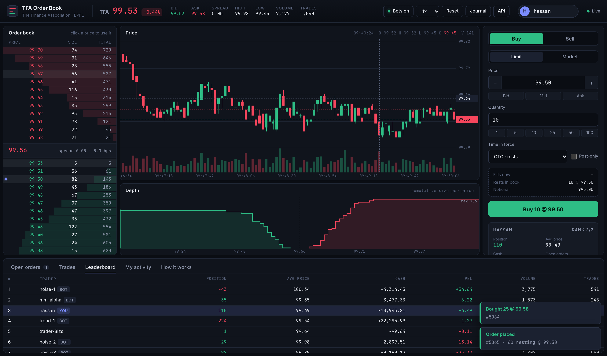

# TFA Order Book

A **price-time priority limit order book and matching engine** in pure Python, with a
**live trading terminal** in the browser where you can trade against simulated market
participants.

Built for The Finance Association (EPFL) onboarding assignment.



```
orderbook/   the engine: pure Python, zero dependencies, deterministic
server/      FastAPI server, simulated traders, web UI (the only layer that reads the clock)
tests/       103 tests: unit, property-based (Hypothesis), journal replay, API
benchmarks/  throughput benchmark
```

---

## Quick start

Requires Python ≥ 3.10.

```bash
git clone https://github.com/hassanprog-h/tfa-orderbook.git
cd tfa-orderbook
python -m venv .venv && source .venv/bin/activate
pip install -e ".[dev]"
```

| What | Command |
| --- | --- |
| Run all the tests | `pytest` |
| Replay the assignment example step by step | `python -m orderbook demo` |
| Launch the trading UI | `python -m server` then open http://127.0.0.1:8000 |
| Interactive API docs (Swagger) | http://127.0.0.1:8000/docs |
| Benchmark | `python benchmarks/bench.py` |
| Rebuild a book from a journal | `python -m orderbook replay journal.jsonl` |

The engine alone needs nothing: `pip install -e .` installs zero dependencies.

---

## Using the API

```python
from orderbook import OrderBook

book = OrderBook()

# The book from the assignment: four asks, no bids.
book.limit("sell", 101, 5)   # order #1
book.limit("sell", 101, 3)   # order #2
book.limit("sell", 102, 2)   # order #3
book.limit("sell", 103, 4)   # order #4

report = book.limit("buy", 102, 12)
report.order_id              # 5
[(t.sell_order_id, t.price, t.quantity) for t in report.trades]
# [(1, 101, 5), (2, 101, 3), (3, 102, 2)]
report.status                # OrderStatus.PARTIALLY_FILLED (2 left, resting at 102)

book.best_bid(), book.best_ask()     # (102, 103)
book.depth(5)
# Depth(bids=[Level(price=102, quantity=2, orders=1)],
#       asks=[Level(price=103, quantity=4, orders=1)])

book.cancel(5)               # True
```

Everything else the engine can do:

```python
book.market("buy", 10)                          # market order, never rests
book.limit("buy", 100, 10, tif="ioc")           # immediate-or-cancel
book.limit("buy", 100, 10, tif="fok")           # fill-or-kill
book.limit("sell", 105, 10, post_only=True)     # rejected if it would trade
book.modify(order_id, quantity=4)               # keeps queue priority
book.modify(order_id, price=99)                 # loses queue priority, may trade
book.limit("buy", 100, 10, trader_id="alice")   # attribute orders to traders

book.subscribe(print)       # every Trade and OrderUpdate, as events
book.spread(), book.mid_price(), book.snapshot(), book.open_orders("alice")
```

Decimal prices are converted at the edge with an `Instrument`:

```python
from decimal import Decimal
from orderbook import Instrument

tfa = Instrument("TFA", tick_size=Decimal("0.01"))
tfa.to_ticks("101.25")   # 10125
tfa.to_ticks(0.1) + tfa.to_ticks(0.2) == tfa.to_ticks(0.3)   # True (unlike floats)
tfa.to_ticks("101.255")  # ValueError: not a multiple of the tick size
```

---

## Design

### Prices are integers (ticks)

The engine only accepts `int` prices, expressed in ticks. Passing a float raises a
`TypeError` that points to `Instrument.to_ticks`. With floats, `0.1 + 0.2 != 0.3`: two
orders meant to be at the same price could end up on different levels, or a buy and a
sell could fail to cross. With integers, price comparison is exact, and cash amounts
(`price × quantity`) stay exact integers too. The conversion to and from a human price
happens once, at the boundary (`Instrument`, used by the web server), with `Decimal`.

### Data structures

```
OrderBook
├── bids: BookSide ─┬── levels: dict[price → PriceLevel]      O(1) lookup of a price
│                   └── heap of prices (max-heap via -price)  O(1) best price
├── asks: BookSide    (same, min-heap)
└── _orders: dict[order_id → Order]                           O(1) cancel / modify

PriceLevel
├── orders: OrderedDict[order_id → Order]   FIFO queue that also supports O(1) removal
└── total_quantity                          kept up to date: depth needs no summing
```

* **Price priority** comes from the heap: its top is always the best price.
* **Time priority** comes from the FIFO queue of each level: new orders go to the back,
  matching takes from the front.
* Together they give price-time priority *by construction*, rather than by sorting.

Why these choices:

* **`OrderedDict` rather than `deque` for a level**: both are FIFO, but cancelling an
  order in the middle of a `deque` is O(n). `OrderedDict` is a hash map plus a doubly
  linked list, so removal by id is O(1). (A plain `dict` also keeps insertion order,
  but repeatedly deleting its first item degrades, because of how CPython stores
  deleted slots.)
* **Heap with lazy deletion for prices**: when a level empties it is removed from the
  `dict` immediately, but stays in the heap until it reaches the top, where it is
  discarded. A set guarantees each price is in the heap at most once (an emptied price
  that comes back simply becomes valid again).

| Operation | Cost (L = number of price levels) |
| --- | --- |
| Add an order to an existing level | O(1) |
| Add an order that creates a new level | O(log L) |
| Cancel / reduce an order | O(1) |
| Best bid / best ask | O(1) amortized |
| Each fill while matching | O(1), plus O(log L) amortized when a level is emptied |
| `depth(N)` | O(L log N) |
| Fill-or-kill liquidity check | O(L log L) over the levels that cross |

On a random flow of limit orders, market orders and cancels, the engine processes
**~400,000 operations per second** on a laptop (`benchmarks/bench.py`), i.e. ~2.5 µs per
operation in pure Python.

### Matching

For an incoming buy (sells are symmetric):

1. While the order has quantity left **and** the best ask is ≤ its limit price (any price
   for a market order):
2. take the **oldest** order at the best ask,
3. trade `min(incoming remaining, resting remaining)` **at the resting order's price**,
4. remove the resting order if it is fully filled, otherwise it keeps its place.
5. Then, if quantity is left: a GTC limit order rests in the book; a market or IOC order
   is cancelled; a FOK order never gets here (it is checked before matching).

Each match produces a `Trade(trade_id, buy_order_id, sell_order_id, price, quantity,
aggressor, buy_trader, sell_trader)`. Trades are **both returned** to the caller (in the
`ExecutionReport`) **and published** as events to subscribers.

### Decisions on what the assignment left open

| Question | Choice |
| --- | --- |
| What does submitting return? | An `ExecutionReport`: `order_id`, `status`, `filled_quantity`, `remaining_quantity` (still resting), `trades`, `reason`, `average_price`. |
| Order ids | Sequential integers from 1, assigned by the book. Deterministic, which makes replay possible. |
| Invalid input (qty ≤ 0, float price, unknown side…) | Raises `ValueError` / `TypeError` immediately: it is a programming error. Nothing is recorded and no id is consumed. |
| Business outcomes (FOK not fillable, post-only crossing) | Not exceptions: the report says `cancelled` / `rejected` with a `reason`. |
| Cancel an unknown / filled order | Returns `False` (cancel is idempotent, no exception). |
| Modify | Reducing quantity at the same price keeps priority; changing the price or increasing quantity is a cancel/replace: same id, back of the queue, may trade immediately. This matches real exchanges, and stops traders from jumping the queue for free. |
| Market order with no liquidity | Cancelled (status `cancelled`, reason "no liquidity left"). It never rests. |
| Self-trade | Allowed by default in the engine (`SelfTradePrevention.NONE`), configurable. The web server uses `CANCEL_RESTING`. |
| Concurrency | The engine is single-threaded by design (like most real matching engines: one thread per instrument, no locks). The server runs everything on one asyncio loop. |

---

## Going further: the extras

### 1. More order types
**Market**, **IOC** (immediate-or-cancel), **FOK** (fill-or-kill), **post-only** (maker
only) and **modify** with correct queue-priority rules. FOK needs care: it must know if
the order *can* be filled entirely without touching the book, so `_fillable` walks the
crossing levels in priority order first, honouring self-trade prevention exactly like
the matching loop would.

### 2. Self-trade prevention
In a trading game, a player trading with themself can fake volume or move the price
for free. With a `trader_id` on orders, the book can **cancel the resting order**,
**cancel the incoming order** or **both** when they would match.

### 3. Event sourcing: journal and deterministic replay
The engine has no clock and no randomness: ids and time priority come from counters.
So the same commands always produce the same book. `Journal` records every valid
command (as JSON lines, optionally to a file) and `replay()` rebuilds the book;
`fingerprint()` hashes the whole state to compare two books in one line. This gives
crash recovery, a complete audit trail, and reproducible bug reports. In the UI, the
**Journal** button downloads the session, which `python -m orderbook replay` rebuilds
exactly.

### 4. Positions and PnL
`Ledger` subscribes to trades and keeps, per trader, the position, the cash (in exact
integer ticks), the break-even price and the mark-to-market PnL. A test checks that the
market is zero-sum (the PnLs always add up to 0).

### 5. A live trading terminal
`python -m server` starts a FastAPI server pushing the market state over a WebSocket
(at most 10 times per second, only when something changed). The UI is plain HTML/CSS/JS
with no build step, and charts drawn by hand on `<canvas>`:

* **Order book ladder** with cumulative depth bars, flashes on changes, a marker on
  levels where you have orders; click a price to use it.
* **Candlestick chart** with volume, best bid/ask guides, last price tag and crosshair.
* **Depth chart** (cumulative size per price).
* **Order ticket** with a **market-impact preview** (estimated fills, average price,
  slippage in bps, what rests or gets cancelled, warnings for FOK and post-only).
* **Open orders** that you can modify inline or cancel, **trade tape**, **PnL
  leaderboard**, **activity log**, and notifications when your resting orders get hit.
* Pause/resume the bots, change their speed, reset the market.

### 6. Simulated market participants
So there is always someone to trade with (`server/simulation.py`):

* **`mm-alpha`**, a market maker, quotes 6 levels on each side and **skews its quotes
  against its inventory**: when it is long it lowers its prices to sell more and buy
  less, the way real market makers manage risk.
* **`noise-1..3`** send random limit and market orders around the fair value.
* **`trend-1`** follows momentum, with a position limit.

The fair value is a random walk *pulled towards the last traded price*, so a human who
trades aggressively genuinely moves the market.

### 7. REST API
Every UI action goes through a documented REST API (`/docs`): place / modify / cancel
orders, read the book, trades, accounts, journal, control the simulation. Inputs are
validated by Pydantic (`422`), engine errors become `400` (e.g. an off-tick price), and
traders can only cancel or modify their own orders (`404` otherwise).

---

## Tests

```bash
pytest            # 103 tests, ~1 s
```

* **Unit tests** (`tests/test_matching.py`, `test_cancel_and_depth.py`,
  `test_order_types.py`, `test_validation.py`): the assignment example, price priority on
  both sides, time priority, execution at the resting price, partial fills of the
  incoming and the resting order, crossing at exactly the best price, sweeping many
  levels, cancel (twice, after a fill, in the middle of a queue, emptying the best
  level), depth, every order type, modify, self-trade prevention, input validation.
* **Differential property-based testing** (`tests/test_properties.py`): Hypothesis
  generates hundreds of random sequences of limits, markets, IOC/FOK, cancels and
  modifies in a narrow price band (so orders cross a lot). Each sequence also runs
  through `ReferenceBook`, a deliberately naive implementation that is obviously
  correct (it scans and sorts every resting order on each match). **Both must produce
  exactly the same trades and the same depth after every step**, and structural
  invariants are checked each time (book never crossed, level totals equal the sum of
  their orders, FIFO order inside each level, index in sync). When a test fails,
  Hypothesis shrinks the sequence to a minimal one. I checked the tests catch real
  bugs: making a level serve its *newest* order first fails them immediately.
* **Replay**: on random sequences, replaying the journal must give the same fingerprint
  and the same trades.
* **Server** (`tests/test_server.py`): REST endpoints, decimal prices, ownership checks,
  WebSocket, and a 300-step simulated session that must stay uncrossed and be exactly
  rebuildable from its journal.
* **Doctests** in the engine modules.

CI runs ruff and the tests on Python 3.10 to 3.13 (`.github/workflows/ci.yml`).

---

## Trade-offs and what I would do next

* **Heap vs. sorted tree vs. array of ticks.** A heap gives O(1) best price and O(log L)
  inserts with the standard library, but depth needs a partial sort. A balanced tree
  (e.g. `sortedcontainers`) would make depth cheaper. Production engines usually use an
  **array indexed by tick** around the current price: every operation is O(1) and
  cache-friendly, at the cost of memory and handling prices outside the band.
* **Python.** The design (hash maps, intrusive queues, integer prices) carries over
  directly to C++ or Rust, where the same engine would be one to two orders of magnitude faster. Python keeps it
  readable, which is the point here.
* **Memory.** Orders and trades are Python objects; a real engine would preallocate
  them in pools to avoid allocation on the hot path.
* **Next steps:** stop orders (triggered by the last price), iceberg orders (hidden
  quantity that refills the visible part and loses priority on each refill), several
  instruments with one book each, risk checks before matching (position / credit
  limits), and snapshots + journal truncation so replay does not start from the
  beginning of time.

---

## Project layout

```
orderbook/
  models.py       Side, OrderType, TimeInForce, Order, Trade, OrderUpdate, ExecutionReport
  book.py         OrderBook, BookSide, PriceLevel: the matching engine
  instrument.py   decimal price <-> ticks
  journal.py      Journal, replay(), fingerprint()
  accounts.py     Ledger / Account: positions and PnL
  __main__.py     CLI: demo, replay
server/
  exchange.py     the engine + timestamps, candles, trade tape, accounts
  simulation.py   market maker, noise traders, trend follower
  main.py         FastAPI app: REST + WebSocket
  static/         index.html, style.css, app.js
tests/            pytest + Hypothesis
benchmarks/       bench.py
notebooks/        my first exploration notes
```

## License

MIT
